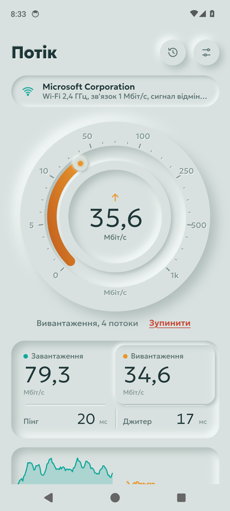
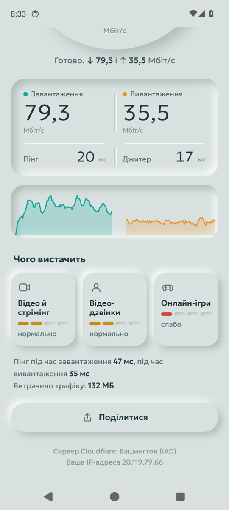
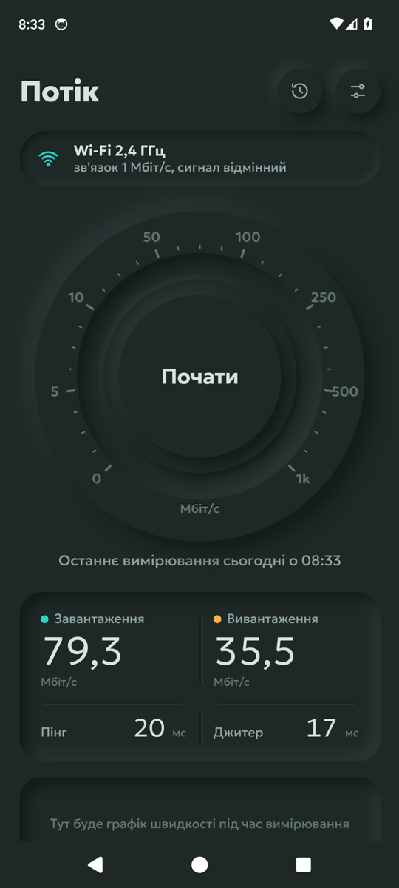

# Потік

Спідтест для Android з неоморфним інтерфейсом: вимірює пінг, джитер, швидкість завантаження й вивантаження та пінг під навантаженням. Показує, чого вистачить вашому інтернету: відео, дзвінкам чи іграм.

[Завантажити APK](https://github.com/hatogg/Potik/raw/main/apk/Potik-1.0.apk)

<p align="center">
  
  
  
</p>

## Що вміє

- **Повне вимірювання за ~25 секунд.** Пінг і джитер, потім завантаження й вивантаження в кілька паралельних потоків. На швидкому каналі «Потік» сам додає потоків, щоб завантажити його повністю.
- **Пінг під навантаженням.** Поки йде завантаження чи вивантаження, «Потік» паралельно міряє пінг. Так видно, чи «задихається» роутер, коли хтось качає файли.
- **Чого вистачить.** Оцінка для відео й стрімінгу, відеодзвінків і онлайн-ігор за методикою Cloudflare: від «погано» до «чудово».
- **Мережа й провайдер.** Wi‑Fi 2,4 / 5 / 6 ГГц, швидкість зв'язку з роутером і сила сигналу, мобільний інтернет, провайдер, сервер вимірювання, IP-адреса.
- **Історія.** Усі вимірювання зберігаються на телефоні; кожне можна відкрити, видалити або поділитися карткою-зображенням.
- **Економний режим для мобільного інтернету** — коротше вимірювання, до 60 МБ трафіку.
- Мбіт/с або МБ/с, світла й темна теми (або як у системі), вібровідгук.
- Без реклами й трекерів, інтерфейс українською.

## Дизайн

Увесь застосунок — ніби один предмет з м'якого матеріалу кольору туману над річкою (у темній темі — нічна ріка). Головний елемент — прилад: опуклий диск із жолобом. Коли починається вимірювання, кнопка в центрі западає й лишається натиснутою, а по жолобу котиться кулька, за якою тече «потік» — бірюзовий для завантаження, бурштиновий для вивантаження. Показник, що вимірюється зараз, «виступає» з утопленого лотка. Шрифт — Geologica.

## Як вимірює

- Сервери — мережа Cloudflare (`speed.cloudflare.com`), автоматично обирається найближчий вузол. Ключі не потрібні.
- Пінг — медіана 20 запитів по «теплому» з'єднанню мінус час обробки на сервері (з заголовка `Server-Timing`, як у відкритому рушії Cloudflare). Джитер — середня різниця між сусідніми вимірюваннями.
- Швидкість — 4–8 паралельних TCP-з'єднань упродовж 10 секунд. Розгін на старті (перші 1,5 секунди, а для вивантаження — поки не спорожніють буфери сокетів), найповільніші 30% і найшвидші 5% відрізків по 250 мс відкидаються, решта усереднюється. Буфер відправки під час вивантаження обмежено, щоб на повільних каналах швидкість не завищувалась.
- Назву провайдера підказує ipinfo.io.
- Повне вимірювання на швидкому каналі може витратити кілька сотень мегабайтів — на мобільному інтернеті варто обрати економний режим у налаштуваннях.

## Збирання

Потрібні JDK 17 і Android SDK.

```bash
./gradlew assembleRelease
```

GitHub Actions збирає APK на кожен push, запускає в емуляторі справжнє вимірювання і зберігає результат і скріншоти в гілку `ci`. Щоб підпис APK не змінювався між збірками, додайте секрет `POTIK_KEYSTORE_B64` (keystore PKCS12 у base64, псевдонім `potik`) і за потреби `POTIK_STORE_PASS`.

## Ліцензії

- Шрифт Geologica — SIL Open Font License.
- Методика оцінок «Чого вистачить» — за відкритим рушієм [cloudflare/speedtest](https://github.com/cloudflare/speedtest).

---

<sub>🇬🇧 **Potik** is a neumorphic speed test for Android: ping, jitter, multi-stream download and upload, loaded latency, and a "what it's good for" rating for streaming, calls and gaming. Measures against Cloudflare's edge (speed.cloudflare.com). No ads, no trackers, Ukrainian UI.</sub>
